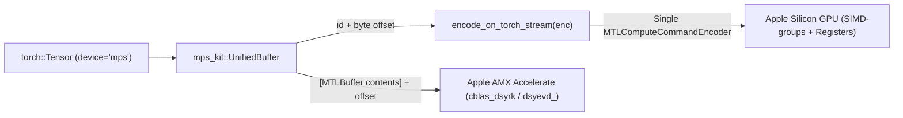

# Architecture & Systems Design

`mps-metal-kit` bridges PyTorch's `mps` backend directly to **Objective-C++20**, **Metal Shading Language (MSL)**, and **Apple Silicon's AMX coprocessor (`Accelerate`)** using Unified Memory at zero copy cost.

---

## 1. Why Standard PyTorch MPS Bottlenecks on Non-Transformer Primitives

On Apple Silicon, Unified Memory physically shares DRAM and last-level cache coherency between CPU/AMX cores and GPU shader cores. However, standard Python/PyTorch `mps` execution incurs four severe bottlenecks whenever an algorithm departs from static dense GEMMs:

1. **Command-Encoder Splits & Dispatch Overhead**: Sequential Python loops over recurrent steps or irregular segments issue hundreds of tiny `MPSGraph` / `MTLComputeCommandEncoder` submissions per layer, starving the GPU of occupancy.
2. **Dynamic-Shape `MPSGraph` Recompilation**: Variable-length segments or ragged masks trigger repeated runtime graph specializations unless padded to worst-case `[B, max_len, D]` rectangles, amplifying wasted FLOPs by `5x-25x`.
3. **Explicit `.cpu()` / `.to("mps")` Copies for `float64` Linear Algebra**: Because Metal shaders do not expose IEEE-754 `fp64` symmetric eigensolvers (`torch.linalg.eigh`), standard PyTorch code copies tensors out of MPS buffers, allocates fresh CPU tensors, runs LAPACK, and copies results back—forcing synchronous pipeline flushes in both forward and backward passes.
4. **Intermediate HBM Materialization in Recurrences**: Naive recurrent or fast-weight updates materialize `[B, H, T, D_v, D_k]` state histories in Unified Memory instead of keeping the `[D_v, D_k]` fast-weight matrix in per-thread GPU registers.

---

## 2. Core C++20 / Objective-C++ Abstractions (`mps_bridge.hpp`)

All primitives in `mps-metal-kit` build on four lightweight abstractions in `include/mps_metal_kit/mps_bridge.hpp`:



### 2.1 `mps_kit::UnifiedBuffer` (Zero-Copy Shared Storage)
PyTorch allocates MPS tensor storage inside `MTLResourceStorageModeShared` buffers. `UnifiedBuffer::from_tensor(t)` extracts:
- `id<MTLBuffer> buffer` and `NSUInteger offset` for direct `[enc setBuffer:buffer offset:offset atIndex:i]` GPU binding, and
- `void* cpu_ptr = static_cast<char*>([buffer contents]) + offset` for zero-copy host/AMX reads and writes after `sync_torch_stream()`.

### 2.2 `mps_kit::encode_on_torch_stream` (Single-Encoder Loop Fusion)
Rather than creating separate command buffers or splitting PyTorch's stream per kernel launch, `encode_on_torch_stream` dispatches onto `at::mps::getCurrentMPSStream()->queue()` and borrows PyTorch's active `id<MTLComputeCommandEncoder>`:

```cpp
mps_kit::encode_on_torch_stream([&](id<MTLComputeCommandEncoder> enc) {
    [enc setComputePipelineState:pso];
    for (size_t wave = 0; wave < num_waves; ++wave) {
        buf_w[wave].bind(enc, 1);
        [enc dispatchThreadgroups:MTLSizeMake(active_tokens[wave], 1, 1)
            threadsPerThreadgroup:MTLSizeMake(256, 1, 1)];
    }
});
```

Dozens of irregular dispatches are encoded in `~15-30 us` of C++ CPU time inside a single encoder without a single host-GPU sync stall.

---

## 3. Kernel Designs

### 3.1 Register-Resident Token Delta Scan (`token_delta_scan`)
For token-level gated fast-weight / DeltaNet recurrences:
$$e_t = v_t - S_{t-1} k_t, \qquad S_t = \gamma_t S_{t-1} + \beta_t e_t k_t^\top, \qquad o_t = S_t q_t$$
with $S_t \in \mathbb{R}^{64 \times D_k}$ ($D_k \in \{64, 128\}$):
- **Register Partitioning**: One threadgroup (`128` threads for $D_k=64$, `256` threads for $D_k=128$) owns one `(batch, head)` stream. Thread `(lane, sg)` (`lane in 0..31`, `sg in 0..D_k/16 - 1`) holds rows `lane` and `lane + 32` across columns `16*sg .. 16*sg + 15` (`32` `float` registers in forward; `64` in backward for `(S, dS)`).
- **Zero-Barrier Transpose Reductions (`simd_sum`)**: Because all 64 rows of column `16*sg + j` reside within the 32 lanes of SIMD-group `sg`, transpose matrix-vector products ($S_t^\top g_{o,t}$ and $\tilde{G}_t^\top (\beta_t e_t) - S_{t-1}^\top g_{e,t}$) reduce to exact hardware `simd_sum` instructions with **zero threadgroup barriers**.
- **`CKI = 16` Checkpointing**: Forward checkpoints $S_t$ every 16 tokens (`16x` smaller memory footprint than full state history). Backward replays each 16-token window once into scratch memory and propagates exact gradients in reverse order.

### 3.2 Register-Resident Chunk Matrix Scan (`deltanet_chunk_scan`)
For WY-factorized chunkwise recurrences $S_{n+1} = \gamma_n M_n S_n + B_n$ ($1 \le D_k \le 64, 1 \le D_v \le 128$):
- Each thread holds up to 32 elements of $S_n$ in registers while staging $M_n$ (`16 KB`) and 32-column strips of $S_n$ (`8 KB`) in threadgroup SRAM (`24 KB` total, safely inside Apple Silicon's `32 KB` threadgroup memory ceiling).
- Backward computes exact $(\nabla M, \nabla B, \nabla \gamma, \nabla S_0)$ in one reverse pass.

### 3.3 Hybrid AMX Forward + Metal Daleckii-Krein Backward (`weighted_gram_subspace`)
Given weighted vectors $X \in \mathbb{R}^{B \times M \times D}$ and non-negative weights $w \in \mathbb{R}^{B \times M}$ with active lengths $L_b \le M$:
- **Forward (Apple AMX `float64`)**: Reads `X` and `w` directly from Unified Memory. When $L_b < D$, forms the **Dual Gram** matrix $C = A_w A_w^\top \in \mathbb{R}^{L_b \times L_b}$ via `cblas_dsyrk`, solves `dsyevd_` in L1 cache, and recovers orthonormal primal eigenvectors $Q = A_w^\top V \Lambda^{-1/2}$ via `cblas_dgemm`. When $L_b \ge D$, solves the **Primal Gram** $G = A_w^\top A_w \in \mathbb{R}^{D \times D}$ directly.
- **Backward (Metal GPU `float32`)**: Differentiates the gauge-invariant projector $P = U U^\top$ entirely on the Metal GPU in $O(M \cdot r \cdot D)$ using the exact Lorentzian regularized Daleckii-Krein + orthogonal-nullspace identity, avoiding any GPU-to-CPU sync in backward.

### 3.4 Prefix-Sum Ragged Multi-Wave Linear (`ragged_waves_linear`)
Packs active `(batch_row, start, stop)` intervals into prefix-sum token offsets `TOK_OFFS`. Launching exactly `total_active_tokens` threadgroups (`1` threadgroup = `1` active token via binary search on `TOK_OFFS`) eliminates rectangular padding amplification while encoding all waves into one Metal command encoder.
